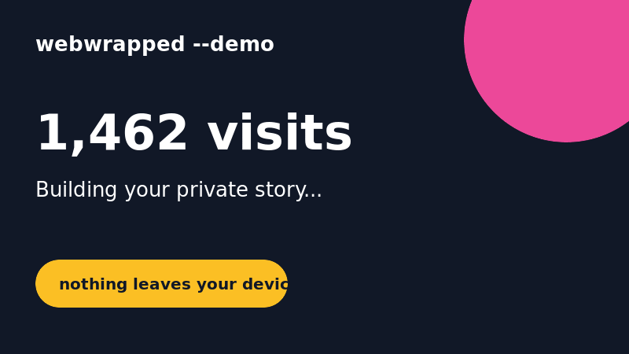
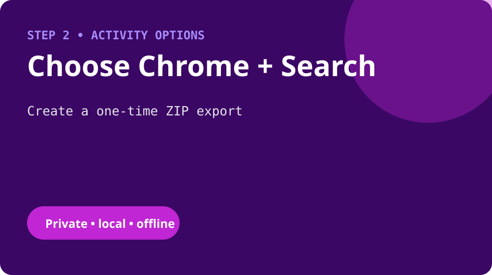
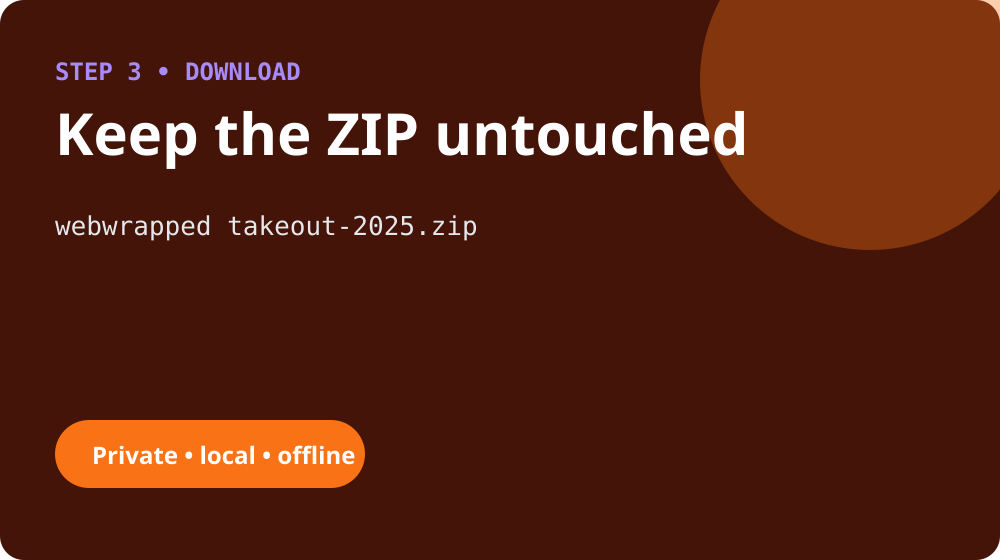

# webwrapped

[](https://github.com/pooria683/webwrapped/actions/workflows/ci.yml)
[](LICENSE)
[](https://python.org)
[](pyproject.toml)

**Your browser history, Wrapped.** One command turns a year of browsing into a colourful, scrollable story and a downloadable 1080×1350 share card.

> **Your history never leaves your machine.** webwrapped has no telemetry, API keys, trackers, or network calls. Parsing, analysis, story generation, and the share-card render all work offline. If you want extra assurance, disconnect your network before running it.

## Quick start

```bash
pipx install webwrapped
webwrapped
```

Or run without installing: `uvx webwrapped`. Preview safely with synthetic data: `webwrapped --demo`.

```text
$ webwrapped --demo --year 2025
WEBWRAPPED 2025
========================
1,462 visits  |  ~121.4 hours
Night owl: 7.5%  |  Longest streak: 306 days
```

The command writes `webwrapped-story.html`, opens it, and keeps everything self-contained. Use **Download share card** at the end of the story.

## Demo



The animation is generated entirely from the synthetic `--demo` dataset.

## Get your full Google Takeout (recommended)

Chromium browsers usually retain only about 90 days locally. Takeout is the best way to make a full-year story.

1. Open [Google Takeout](https://takeout.google.com/) and choose **Deselect all**.<br>
   
2. Select **My Activity**, then include **Chrome** and **Search** activity. Create a one-time `.zip` export.<br>
   
3. Download the untouched ZIP and run:<br>
   
   ```bash
   webwrapped ~/Downloads/takeout-*.zip --year 2025
   ```

The visual guide is illustrative; Google’s wording can vary by account.

## Supported sources

| Source | Auto-detected | Notes |
|---|---:|---|
| Chrome, Chromium, Edge, Brave, Arc, Vivaldi | ✓ | Copies locked SQLite DB before reading; local history is often only ~90 days |
| Firefox | ✓ | `places.sqlite` can contain years |
| Safari | ✓ | Supports `History.plist` and modern `History.db` |
| Google Takeout Chrome + Search | ZIP/path | Full-year flagship source; raw ZIP accepted and JSON is streamed |

Multiple detected databases are merged and duplicate timestamped URLs removed.

## Commands

```bash
webwrapped                         # current year, auto-detect browsers
webwrapped --year 2025
webwrapped takeout-2025.zip
webwrapped --sources chrome,firefox
webwrapped --demo
webwrapped --json > stats.json
webwrapped --redact                # generic labels inside share card
webwrapped --out my-story.html
```

## What it finds

Visits and estimated active hours; busiest day/hour; night-owl score; top and loyal sites; weekly topic eras; cross-domain rabbit holes; Google queries and after-midnight questions; YouTube watch URLs; most-revisited page; and the longest daily streak.

## FAQ

**Where does my data go?** Nowhere. The program reads local files and writes local HTML/JSON. The HTML contains no remote assets.

**Why group by site rather than URL?** Site-level rankings reveal useful patterns without letting a single site’s many paths drown the list. The most-revisited-page insight still tracks exact URLs.

**Why is my local history only about 90 days?** Chromium routinely removes older local visits. This is browser behaviour, not a webwrapped limit. Add your Google Takeout ZIP for full-year Chrome and Search activity.

**Can I share safely?** `--redact` changes the share card’s site labels to generic names. Review any image before posting it.

## Development

Python 3.10+, standard library only at runtime. See [CONTRIBUTING.md](CONTRIBUTING.md).

```bash
pip install -e '.[dev]'
pytest
```

MIT licensed.
